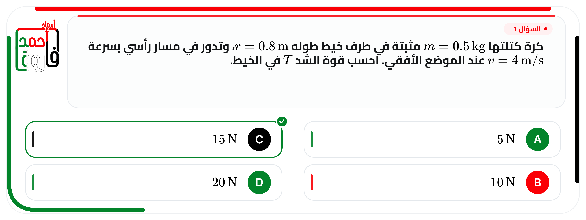

# بطاقة سؤال — قالب أستاذ أحمد فاروق (v2)

قالب HTML لبطاقات أسئلة الاختيار من متعدد، بمقاس **1600×603**، يدعم **المعادلات الرياضية** بأسلوب محرّر معادلات Word داخل النص العربي (RTL) بدون أي خلط في الاتجاه.



## المميزات

- **خطوط عربية**: قائمة فيها أكثر من 20 خط (Cairo, Tajawal, Almarai, IBM Plex Sans Arabic, Noto Kufi, Amiri, Naskh…) تُحمَّل من Google Fonts، والخط يُضمَّن داخل ملف PNG عند التصدير حتى يطابق التصدير المعاينة.
- **معادلات LaTeX**: `$...$` داخل السطر و`$$...$$` في سطر مستقل، مع أزرار جاهزة (كسر، جذر، أُس، متجه، وحدة…) وقائمة رموز.
- **عزل اتجاه المعادلة**: كل معادلة تُرسم كوحدة LTR معزولة، فلا تُقلب الجملة العربية ولا تختلط الأرقام بالحروف.
- **حماية من فيضان النص**: تصغير تلقائي ثم قص مع تحذير، حتى لا يرسم النص فوق الاختيارات.
- **شكلان للكارت**: نص فقط، أو سؤال بصورة (رفع / لصق `Ctrl+V`).
- **رقم السؤال** و**علامة الإجابة الصحيحة** (اختياري).
- **تصدير**: SVG، PNG 1600×603، PNG @2x، وطباعة/PDF بمقاس 400×150.75mm.
- **حفظ تلقائي** في المتصفح لكل الإعدادات.
- **وضع الدفعة**: لصق أسئلة بصيغة TSV أو JSON ثم تحميل كل الكروت مرة واحدة.

## الاستخدام

افتح `index.html` مباشرة (دبل كليك) أو من خلال GitHub Pages.

1. اكتب نص السؤال.
2. لتحديد جزء كمعادلة: ضعه بين `$...$`، أو حدّده واضغط زر **«معادلة»**.
3. اختر الخط وشكل الكارت ورقم السؤال والإجابة الصحيحة.
4. نزّل PNG أو SVG أو اطبع PDF.

### أمثلة على المعادلات

| الغرض | الطريقة |
|---|---|
| معادلة داخل السطر | `احسب الشد $T=mg\cos\theta$ في الخيط` |
| معادلة في سطر مستقل | `$$E = mc^2$$` |
| كسر | `$\frac{mv^2}{r}$` |
| جذر | `$\sqrt{2gh}$` |
| وحدة | `$5\,\text{N}$` |
| زاوية | `$\theta = 30^{\circ}$` |

## الملفات

| الملف | الوصف |
|---|---|
| `index.html` | التطبيق كامل (اللوجو مضمّن داخله) |
| `mathjax-tex-svg.js` | محرّك MathJax 3 لرسم المعادلات (لازم يكون جنب `index.html`) |
| `preview.png` | صورة معاينة |

> لو حذفت `mathjax-tex-svg.js`، الصفحة تحاول تحميل المحرّك من CDN تلقائيًا، وهذا يحتاج اتصالًا بالإنترنت.

## واجهة برمجية

```js
QuestionCard.render({ q: '...', a: '...', b: '...', c: '...', d: '...', correct: 'B' });
await QuestionCard.png(2);   // Blob
await QuestionCard.toSVG();  // Blob
```

## ملاحظات

- أول فتح يحتاج إنترنت لتحميل الخط من Google Fonts، ثم يُخزَّن في المتصفح.
- الخطوط لا تُثبَّت على الجهاز؛ تُحمَّل كملفات ويب فقط.
